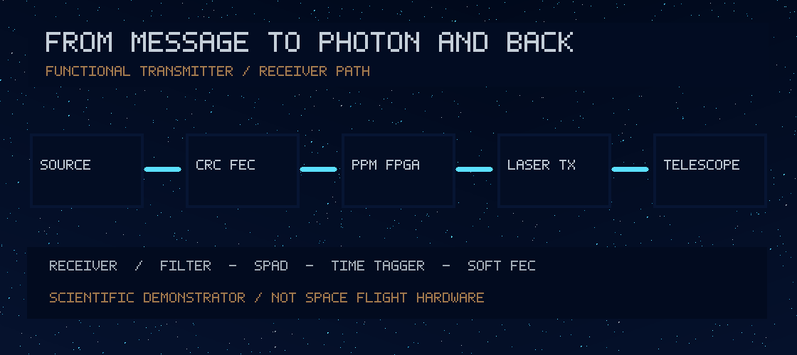
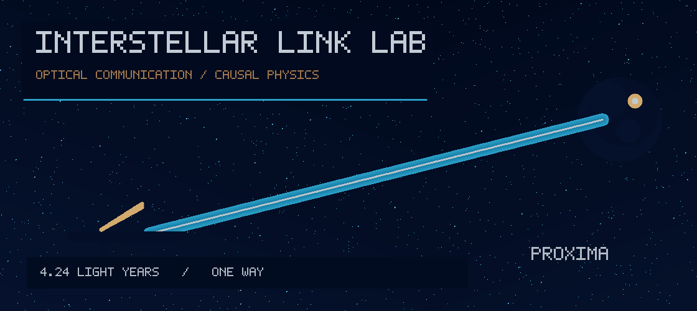
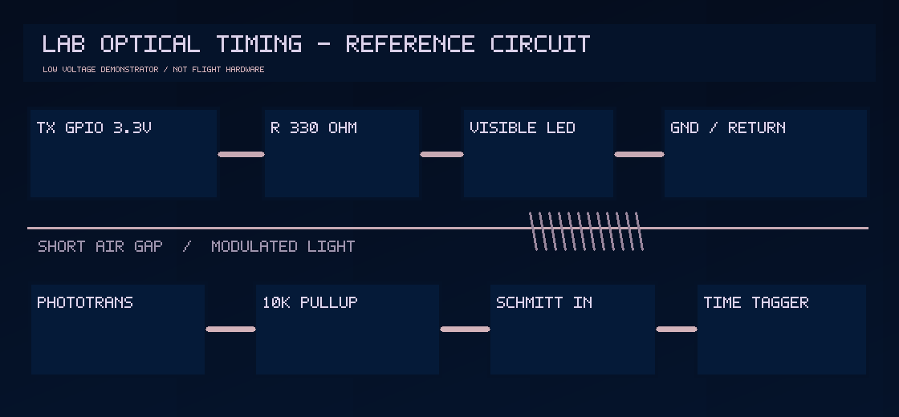
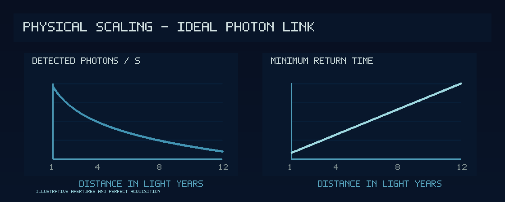

# Interstellar Link Lab

## Latest research — pointing fades and whole-message reliability (26 October 2026)

[**Explore the interactive, raster-canvas experiment**](https://biswajit1999.github.io/Interstellar-Link-Lab/pointing-study.html) · [**Read the derivation and primary literature**](docs/research/POINTING_FADES_VS_MEAN_PHOTONS_2026.md) · [**Run the Python model**](research_tools/pointing_fade.py) · [**Inspect independent tests**](research_tools/tests/test_pointing_fade.py)

A photon-starved link's **mean received power can drastically overestimate whole-message reliability** when the pointing error persists throughout a packet. A deliberately artificial Gaussian-optics, zero-background 8-PPM example with 1.0 µrad pointing jitter per axis gives approximately **30.5%** correct uncoded 16-symbol packets after accounting for packet-correlated pointing, against **99.2%** from an invalid mean-power-only shortcut. This is a numerical demonstration, not measured terminal performance or the earlier uniform-pupil Airy link model. The interactive page draws an ordinary raster chart with HTML Canvas (no SVG artwork).

**Photon-efficient deep-space communication, optical transceiver design, moving-endpoint relativity, and the search for physically viable communication paths beyond the ordinary light-cone benchmark.**

**Research lead:** Biswajit Jana · **Project state:** active computational research · **First public release:** October 2026

[**Explore the interactive observatory (GitHub Pages)**](https://biswajit1999.github.io/Interstellar-Link-Lab/) · [**Read the technical report as a website**](https://biswajit1999.github.io/Interstellar-Link-Lab/report.html) · [**Run the Python experiments**](#reproduce-the-calculations) · [**Inspect the complete research question**](docs/research/ORIGINAL_BEYOND_THE_LIGHT_CONE.md)

> **The question:** If Earth sends a newly chosen message to a receiver near Proxima Centauri, can that receiver learn the message before an ordinary light ray would arrive—and, if not, how close can we get to the best communication system allowed by physics?

The answer currently has two distinct parts. **We can improve how many verified bits arrive per received photon.** We have no experimentally established means of making a *freshly chosen bit* propagate faster than light in vacuum. This project treats those statements separately and tests each model rather than claiming a discovery.

## Start with the physical system

*Fig. 1 — Conceptual data-to-optics and photon-to-data architecture. Original PNG artwork, not a flight-qualified circuit or actual interstellar photograph.*

The chain starts with new scientific data, produces error-detectable and error-corrected frames, assigns pulse times in a modulator, drives an optical terminal, propagates a diffracting beam, and reconstructs receiver data from photon time tags. Packet integrity determines whether a measurement can be called **fresh and recovered**, or must remain an explicit prediction.

*Fig. 2 — Low-voltage transmitter/sensor/timestamping functional chain. This is a concept drawing, not an electrical schematic suitable for fabrication. Pin-level wiring and cautions appear in the [research report](docs/report.html#electronics).*

The longer-term instrument is **bidirectional**. Both Earth and the remote terminal would need a transmitter, receiver, shared timing strategy, autonomous acquisition/pointing and power-management system. Even an immediate response traverses the same separation again.

| Quantity | Illustrative reference | What it actually says |
|---|---:|---|
| Earth–Proxima static separation | 4.24 ly | A reference length, not a fitted 2026 ephemeris |
| Earliest ordinary one-way propagation | ~4.24 years | Before payload size, coding or receiver integration time |
| Earliest ordinary request and immediate reply | ~8.48 years | Before remote processing and clock uncertainty |
| Ideal detected photon rate, example | ~0.363 s⁻¹ | *10 W; 1 m transmit; 10 m receive; 1064 nm; 20% efficiency; perfect acquisition* |
| Physical faster-than-light transmitter | **Not demonstrated** | Warp/wormhole hypotheses do not supply a validated hardware design |

The nominal photon calculation uses an unobscured circular pupil and a small receiver relative to the diffraction pattern; the extensive pointing and detector losses required for a mission-grade link are not included. **Do not treat the result as a realizable instrument performance figure.**

## Explore the research as a website

The static site operates without a server-side application. It includes an interactive optical-photon budget, a synthetic Poisson PPM experiment, research chapter navigation, and separate instrument and causal-physics explanations.

**[Open the research interface](https://biswajit1999.github.io/Interstellar-Link-Lab/)** · **[Open the scientific report](https://biswajit1999.github.io/Interstellar-Link-Lab/report.html)**

The controls are deterministic and the browser can export its parameter state and synthetic outputs as JSON. The site does **not** connect to an actual detector or spacecraft.

To publish as GitHub Pages, select **Settings → Pages → Deploy from branch → main → /docs**. This setting is controlled by the repository owner and is not presumed active.

## Three linked research programmes

### Photon Frontier — build the best physical link

The hardware and communication focus is the number of **CRC-verified new information bits** per photon, joule, second of active transmission and optical aperture investment.

- Photon-counting OOK and M-ary pulse-position modulation with exact or seeded Poisson detection controls.
- Soft-decision PPM, convolutional FEC/Viterbi experiments and protected packet framing.
- Pointing jitter, optical throughput, apertures, event timestamp noise and background counts.
- Predictive image transmission: send information *not already present* at the receiver and expose unrecovered tiles as uncertain.
- An experimentally grounded electronics path from a 3.3 V LED loopback to qualified single-photon detector modules.
- Closed-loop beam steering, thermal metrology, acquisition and time synchronization as required instrument subsystems.

### Causal Frontier — distinguish correlation from communication

The [Bell-state simulation](research_tools/quantum_no_signal_lab.py) tests receiver-only marginals when Alice changes measurement basis. Bob's unconditional local outcomes remain independent of Alice's newly chosen setting. A deliberate inserted classical leak is a positive control, **not** an entanglement channel.

Two scientific targets must be distinguished. A **spacetime shortcut** could, in principle, beat a *well-defined external reference light-time* while following null or timelike curves of its own physical metric, if that metric and its sources could actually exist. A stronger **causality-violating claim** requires a fresh randomized input X inferred at an event B outside the actual metric's future causal set J⁺(A). Neither is demonstrated. Both demand calibrated clocks, source dynamics, leakage audits and replication.

### Causal Corridor — test speculative spacetime physics

The original [Beyond the Light Cone report](docs/research/ORIGINAL_BEYOND_THE_LIGHT_CONE.md) and the [falsifiable causal protocol](docs/research/CAUSAL_TEST_PROTOCOL.md) provide a starting ledger for warp metrics, Krasnikov-type corridors, wormholes and Hyperwave. None is a demonstrated instrument.

Every candidate requires a specified metric and physically defensible matter/source model, the Einstein tensor, the relevant energy and conservation checks, null/timelike curves, global chronology and a realistic preparation process. **Arriving early against a background metric is not proof of outrunning the light cone of the actual metric.**

*Fig. 3 — Original raster numerical tradeoff figure. The left panel uses the explicitly idealised optical baseline, scaling as inverse distance squared; the right panel shows the ordinary two-way vacuum light-time benchmark. Neither curve represents a demonstrated FTL channel.*

## Reproduce the calculations

Python **3.11 or newer** is recommended for the standard-library reference programs.

~~~bash
python -m unittest discover -s research_tools/tests -v
python -m research_tools.interstellar_optical_budget
python -m research_tools.relativistic_geometry
python -m research_tools.photon_statistics
python -m research_tools.quantum_no_signal_lab
python -m research_tools.modulation
~~~

| Python source | Scientific role | Status |
|---|---|---|
| [interstellar_optical_budget.py](research_tools/interstellar_optical_budget.py) | Small-receiver far-field photon rate and static light time | Idealized analytic model |
| [relativistic_geometry.py](research_tools/relativistic_geometry.py) | Inertial 3D moving-endpoint null intercept, round trip and point-ahead | Constant-velocity baseline; no real ephemeris |
| [photon_statistics.py](research_tools/photon_statistics.py) | Synthetic photon-counted PPM under pointing jitter/background and Wilson uncertainty | Seeded Monte Carlo, toy detector |
| [modulation.py](research_tools/modulation.py) | OOK/PPM uncoded information trade studies | Ideal statistics, not a CCSDS modem |
| [quantum_no_signal_lab.py](research_tools/quantum_no_signal_lab.py) | Born-rule Bell statistics and deliberate classical-leak positive control | Ideal quantum simulation, no physical separated experiment |
| [advanced/](research_tools/advanced/) | Soft PPM, convolutional FEC and frame experiments | Software demonstration; hardware verification outstanding |
| [tests/](research_tools/tests/) | Regression controls | Automated source tests; check Actions for most recent result |

The [active-optics pointing loop](research_tools/pointing_control.py) adds finite-bandwidth two-axis control, electronic sensor noise and an approximate optical pointing-overlap model.

The browser code lives in [docs/index.html](docs/index.html), [docs/scripts.js](docs/scripts.js) and [docs/styles.css](docs/styles.css). PNG research assets are under [docs/images/](docs/images/).

## Next-generation transceiver: the instrument-level questions

A credible terminal needs separate data, timing, pointing and safety/control loops. The [two-way transceiver research note](docs/research/TWO_WAY_TRANSCEIVER_ENGINEERING_2026.md) specifies these chains, while the [illustrated field guide](docs/research/ILLUSTRATED_FIELD_GUIDE.md) explains the concepts in plain language.

**Electronic demonstration:** 3.3 V GPIO → 330 Ω series resistor → visible LED → short enclosed optical gap → phototransistor with a 10 kΩ pull-up → compatible digital threshold/time stamp. This is a **reference teaching circuit**, not an approved PCB, and every electrical component and sensor interface must be checked before assembly.

**Research terminal:** an independently interlocked optical transmitter, telescope and point-ahead mechanism, closed-loop pointing, spectral/temporal filtering, commercial qualified SPAD/SNSPD photon-counting modules, time-to-digital conversion, clock/synchronization recovery, and error-corrected packet verification. Neither the high-voltage detector electronics nor the optical power subsystem has been fabricated or qualified here.

## What could make this work scientifically valuable decades from now?

A useful long-lived research record is not just a futuristic visualization. It needs:

1. **Physics that can be falsified:** explicit variables, units, coordinate choices, the actual metric and statistical decision rules.
2. **Implementation that can be repeated:** source files, pinned dependencies where required, benchmark inputs, deterministic seeds and checksums.
3. **Measured hardware:** schematics, PCB revisions, component specifications, calibrations, clock logs and raw photon time tags *when actual prototypes exist*.
4. **Trade studies:** photons/bit, accepted frame errors, optical power and aperture, target motion, pointing and environmental margins.
5. **Negative results:** failed spacetime hypotheses and unexplained effects preserved alongside successful tests, without renaming them as discoveries.
6. **A maintained source trail:** primary publications, catalog versions, DOI links, observation epochs and honest attribution.

**Research work packages:** optical end-to-end calibration → component-specific electronics and ECAD → measured photon-counted link → epoch-specific Earth/Proxima geometry → independent numerical-GR baseline → falsifiable candidate metric evaluation.

## Literature and standards

- [NASA/JPL — Deep Space Optical Communications](https://www.jpl.nasa.gov/missions/deep-space-optical-communications-dsoc/) — an optical data-transfer precedent, not FTL.
- [CCSDS](https://ccsds.org/) — consult applicable optical coding, synchronization and physical-layer recommendations before claiming compliance.
- [Bennett et al., *Phys. Rev. Lett.* **70**, 1895 (1993)](https://doi.org/10.1103/PhysRevLett.70.1895) — teleportation uses a classical channel.
- [Everett and Roman, *Phys. Rev. D* **56**, 2100 (1997)](https://arxiv.org/abs/gr-qc/9702049) — theoretical Krasnikov geometry.
- [Alcubierre and Lobo (2021)](https://arxiv.org/abs/2103.05610) — warp-drive spacetime review.
- [Original research brief](docs/research/ORIGINAL_RESEARCH_BRIEF.md), [technical audit](docs/research/LITERATURE_AUDIT.md), and [original archived report](docs/research/ORIGINAL_BEYOND_THE_LIGHT_CONE.md). Historical citation placeholders are identified in the archive and are not independently verified sources.

---

Research lead **Biswajit Jana** · Interstellar Link Lab · 2026. No external institute endorsement, flight qualification or experimentally confirmed faster-than-light channel is claimed.

**Why the project exists:** to push credible interstellar communications engineering as far as demonstrable physics allows, while preserving a mathematically explicit and independently testable route for extraordinary hypotheses.
