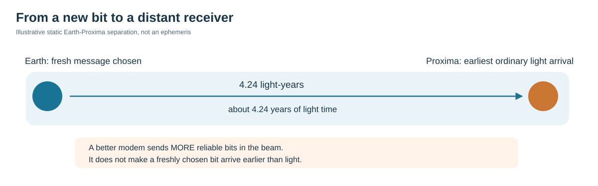
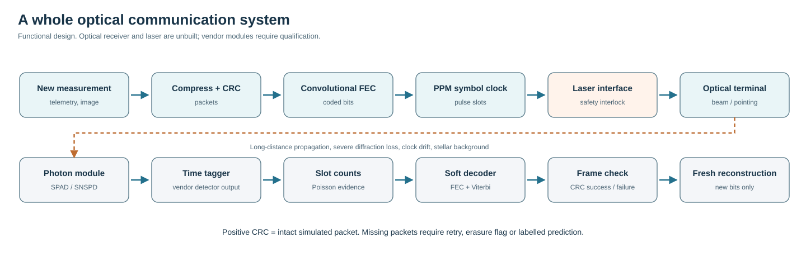
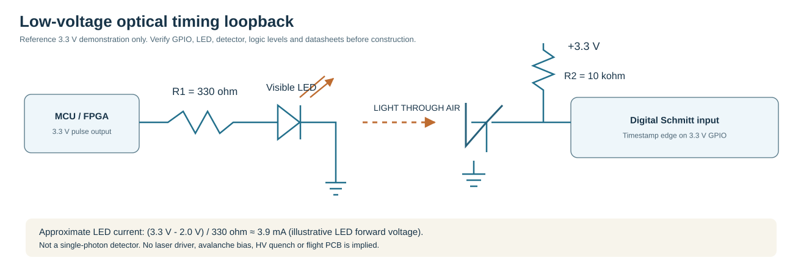
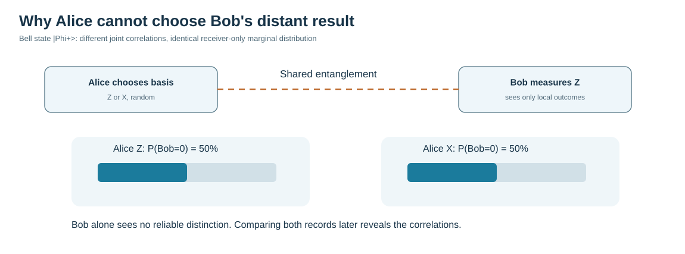

# Interstellar communication, from the first bit to the detector
*An illustrated laboratory walk-through, 26 October 2026 · Research lead: Biswajit Jana*

**The original question:** Could a newly chosen message on Earth reach Proxima Centauri sooner than a light signal? Our work must distinguish increased data rate from faster-than-light propagation. At an illustrative static distance of 4.24 light-years, the ordinary light time is approximately 4.24 years. Real targets move, so a mission needs time-tagged astrometric data.

## What happens to a message?

A new scientific observation is packaged with error-detection information, protected by an error-correcting code, and converted into a time-dependent optical signal. A telescope directs the laser energy into space. Only a very small fraction of the photons are collected at the other end. A photon-counting detector provides electronic event times, and a decoder estimates the source bits.

This block diagram separates data preparation, electronic pulse timing, optics, propagation, detector readout and receiver decisions. A robust implementation needs acquisition, clock recovery, pointing feedback and calibrated backgrounds in addition to the illustrated blocks.

## Modulation: moving the flash

With **on-off keying (OOK)**, an illuminated time interval can represent one and darkness can represent zero. With **8-position pulse-position modulation (8-PPM)**, a single pulse is assigned to one of eight time slots; that position encodes three raw bits. Low photon counts make slot decisions uncertain, especially if background photons arrive.

The [existing modulation code](../../research_tools/modulation.py) compares simplified Poisson OOK and PPM channels. The [advanced soft decoder and coding experiments](../../research_tools/advanced/) model more of the receiver chain, but do not constitute a standard-compliant flight modem.

## Electronics we can physically investigate

A useful first demonstration needs no hazardous laser and no avalanche detector. A **3.3 V digital controller** drives a small visible LED through a current-limiting resistor. A phototransistor on the other side of a short gap generates a changing voltage at a resistor pull-up node. A suitable Schmitt input records the transitions.

Assuming a forward voltage of 2.0 V, a 330-ohm series resistor produces an approximate current of (3.3 - 2.0) / 330 = **3.9 mA**. That 2.0 V is illustrative, not measured. The exact GPIO drive limit, device pinout, LED forward voltage, collector current, rise time, voltage threshold and pull-up requirements must be checked against the chosen components before wiring. This is a conceptual circuit, **not a validated PCB**.

The later single-photon architecture is different: optical filters, a qualified SPAD or SNSPD module, a time-to-digital converter, and an FPGA or computer implementing slot alignment, photon counts and soft decoding. SPAD bias/quenching, SNSPD cryogenics and laser-driver circuits require equipment-specific safety engineering; they are not supplied as a ready-to-build high-voltage circuit here.

## Why coding and prediction help

Some pulses cannot be distinguished from background or are never detected. The coded-PPM model estimates whole-frame acceptance rather than treating each raw bit as perfect. Report every simulated frame-success rate with the photon/noise assumptions, trial count and uncertainty interval.

A predicted image can reduce the number of bits to send: the sender transmits *changes* relative to shared earlier data. The receiver reconstructs a fresh pixel only when the corresponding protected packet arrives. The synthetic 36-tile demonstration accepted all 36 tiles under a strong toy channel but only nine under a weaker channel; the remainder showed explicitly marked fallback predictions. Prediction is **not** early delivery of newly observed information.

## Why entanglement does not make the message arrive early

For the ideal Bell pair, Bob's reduced quantum state is one-half of the identity matrix. Bob's unread local result probabilities remain 50/50 whether Alice secretly chooses the X or Z measurement basis. Correlations appear when the two records are brought together later.

The [no-signalling derivation and Python experiment](research/QUANTUM_NO_SIGNALLING.md) test this result with a null control and a deliberately introduced classical leak. Quantum teleportation also requires classical communication; see [Bennett and colleagues, 1993](https://doi.org/10.1103/PhysRevLett.70.1895).

## What would count as a genuine FTL result?

A fresh independently random message chosen at event A must be locally recoverable from a remote event B **outside the actual physical causal future of A**. Earlier arrival than a reference light ray does not suffice for a speculative curved metric: its physical causal structure, stress-energy sources, energy conditions and global chronology must be validated. The [causal test protocol](research/CAUSAL_TEST_PROTOCOL.md) specifies the side-channel and timing checks. **No validated FTL channel exists in the current project.**

## What we need to measure next

| Study | What we log | What it tests |
|---|---|---|
| Digital timing loopback | GPIO pulse edges, jitter | Real clock timing |
| Visible LED optical loopback | Detector voltage and timestamp errors | Actual electronic-to-optical coupling |
| Qualified photon-counter experiment | Photon time tags, background, dark counts | Model-to-detector agreement |
| PPM and FEC link | Symbol, bit and whole-frame errors | Noise, coding and synchronisation |
| Earth-Proxima geometry | Source epoch, distance, transverse motion | Light-time and pointing uncertainty |
| Hypothetical spacetime metric | Causal sets, stress-energy, source model | Physical consistency of proposed paths |

This guide is an accessible companion to the original [Beyond the Light Cone research report](research/ORIGINAL_BEYOND_THE_LIGHT_CONE.md). The earlier material contains exploratory hypotheses and must not be read as a verified demonstration. A 15-page PDF version with additional generated illustrations, modulation plots, synthetic reconstruction images, detector architecture and circuit diagrams was also produced; that **binary PDF is distributed separately and has not been uploaded to this GitHub repository**.

The [NASA/JPL DSOC technology demonstration](https://www.jpl.nasa.gov/missions/deep-space-optical-communications-dsoc/) is a valuable real optical-communication precedent, but its 267-Mb/s result at about 31 million km is not an interstellar link demonstration.

*All diagrams are explanatory or functional designs. No constructed hardware, qualified PCB, experimentally verified photon-starved channel or faster-than-light communication is claimed.*
