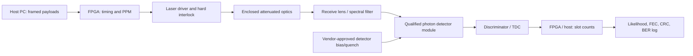

# Optical transmitter, channel and receiver

**Research lead:** Biswajit Jana  
**Status:** Unbuilt reference architecture. These are block/interface diagrams; not a tested electrical schematic, KiCad design, bill of materials or CCSDS-compatible terminal.

## Functional system diagram

The time for newly generated information to arrive is bounded by propagation time and transmission duration. Prediction alone is not a newly received message.

## Electrical timing and readout interfaces

### Low-voltage example, not a SPAD schematic

A 3.3 V GPIO pulse output can illuminate a visible LED through an illustrative **330 ohm series resistor**. If the LED has a nominal 2.0 V forward drop, current is about (3.3 - 2.0) / 330 = **3.94 mA**. Verify the actual LED and GPIO rating, output drive capability and board electrical limits before use. A phototransistor with a **10 kilohm pull-up to 3.3 V** may feed a qualified Schmitt input; its speed, thresholds and ambient light sensitivity require bench measurement. This is suitable only for low-voltage optical timing loopback and is **not** a single-photon modem.

The photon-count receiver needs a specified commercial SPAD/SNSPD module, proper avalanche quenching or cryogenic readout, verified isolation and instrument interlocks. No arbitrary avalanche bias voltage, PCB layout or laser safety approval is supplied.

## Validation order

1. Simulation against analytical Poisson slot-count laws and seeded reference vectors.
2. Electronic pulse/timing loopback with calibrated scope and explicit time-base uncertainty.
3. Enclosed, low-power optical LED timing loopback; measure jitter and lost edges.
4. Selected qualified photon-counting instrument: acquire dark count, dead time, afterpulsing and detection-efficiency measurements.
5. Coded BER/FER data versus count rate, compared with a fixed-power simulation and declared statistical intervals.
6. Actual astrometry and pointing covariance, flight terminal power/thermal feasibility and independent safety review.

The reference numerical study: [modulation experiments](../docs/research/MODULATION_RESULTS.md).